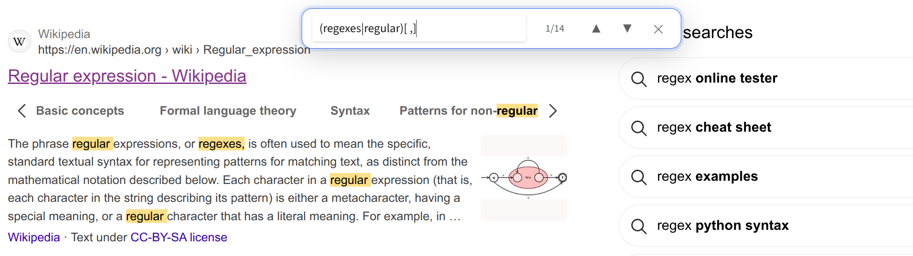

# Chrome Regex Finder

一款支持用正则表达式搜索页面文本的 Chrome 浏览器扩展。

## 特性

- 支持多种正则方言变体: `POSIX ERE`、`POSIX BRE (grep/sed)`、`PCRE (Legacy)`、`PCRE2 (PHP)`、`JavaScript`、`Python (re)`。
- 支持国际化多语言: 英文、简体中文、繁体中文、日语、韩语、德语、法语、俄语，默认**跟随浏览器语言**。
- 支持自定义快捷键 (默认为 `Ctrl+Shift+F`)。
- 搜索框使用自定义 `<input>` 标签，不会与 Vimium 之类的扩展抢占输入焦点。

## 下载

[Releases · kitty-panics/chrome-regex-finder]

[Releases · kitty-panics/chrome-regex-finder]: https://github.com/kitty-panics/chrome-regex-finder/releases

## 安装

1. 打开 `chrome://extensions`。
2. 右上角开启 **开发者模式**。
3. 将 **chrome-regex-finder.crx** 拖动到浏览器窗口进行安装。
4. 在任意网页按下快捷键，输入正则表达式即可。

## 截图

#### 设置页面

#### 搜索示例

